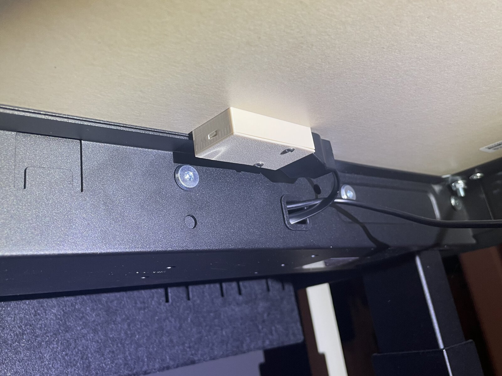
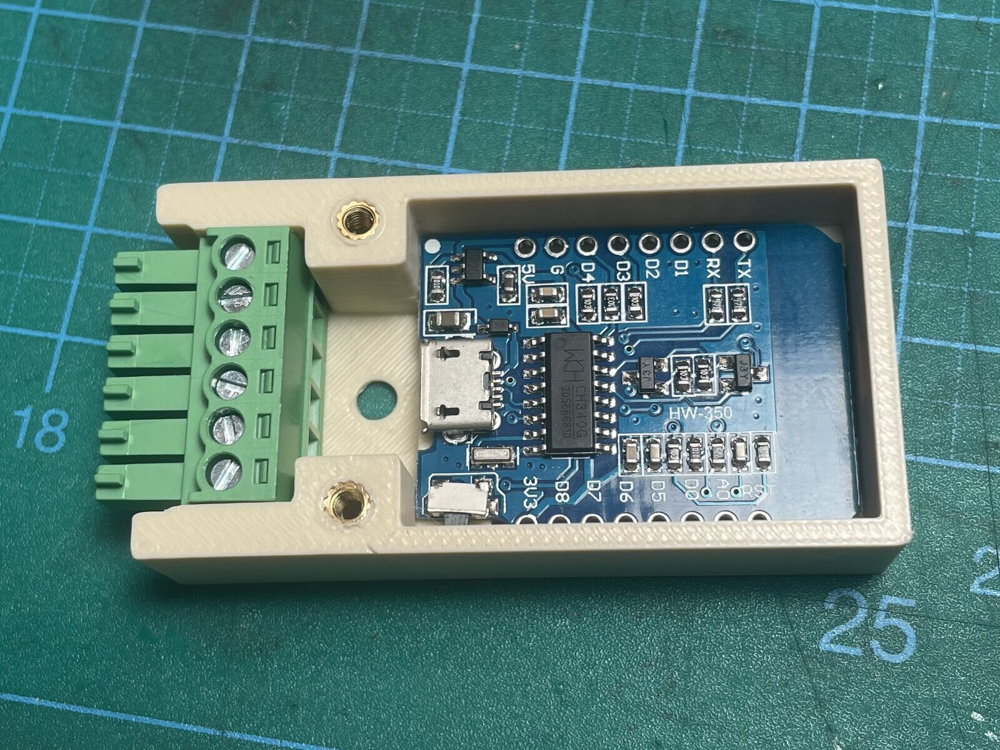
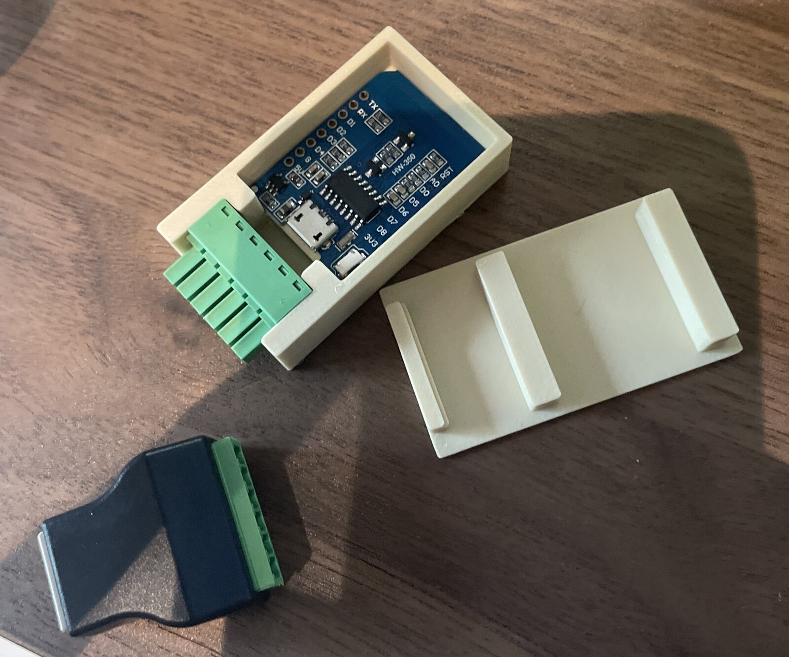
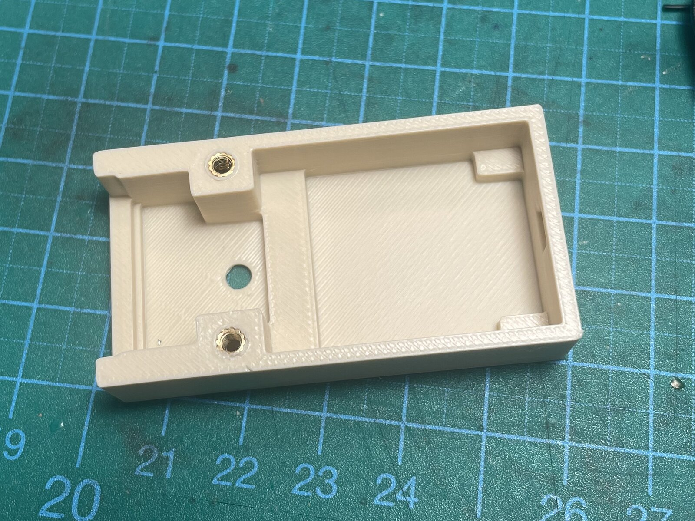
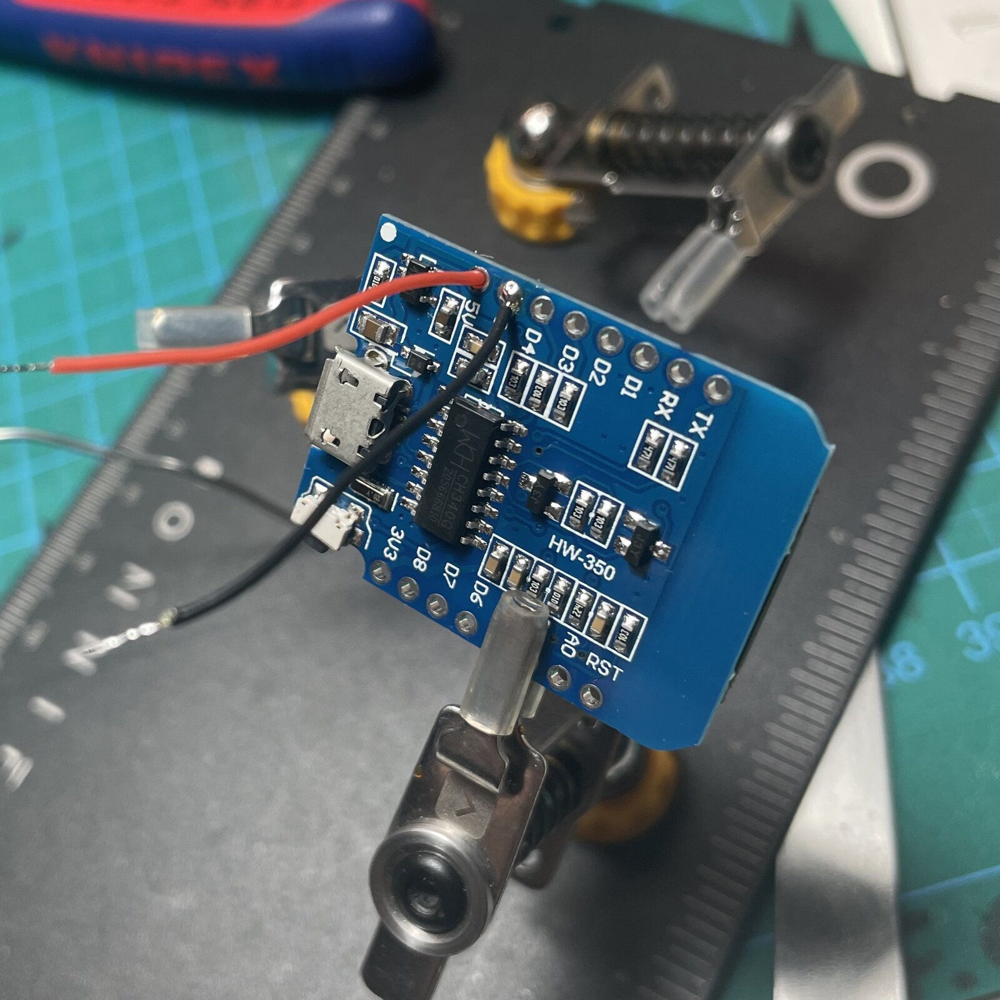
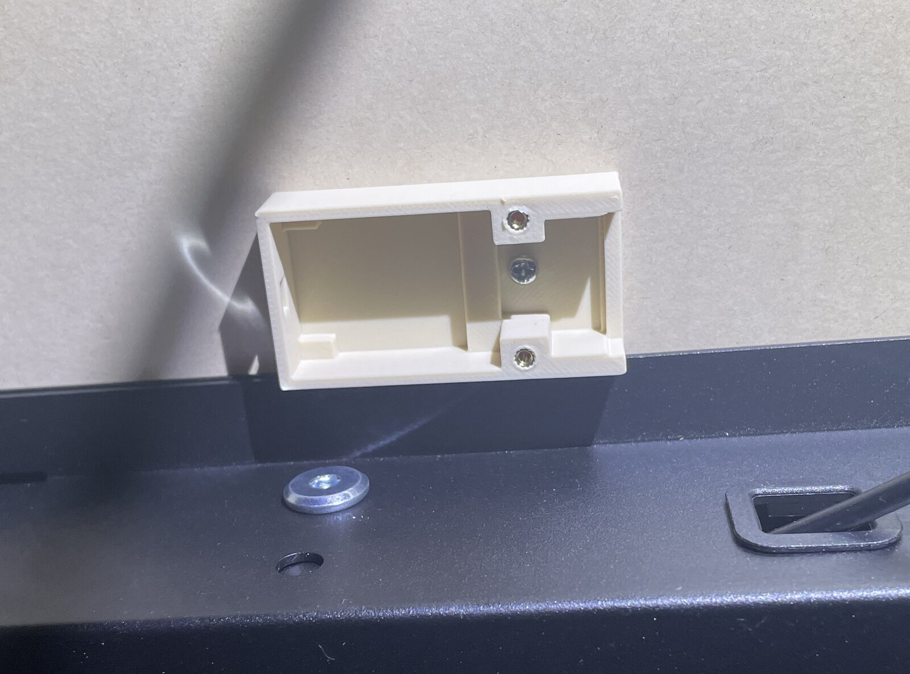
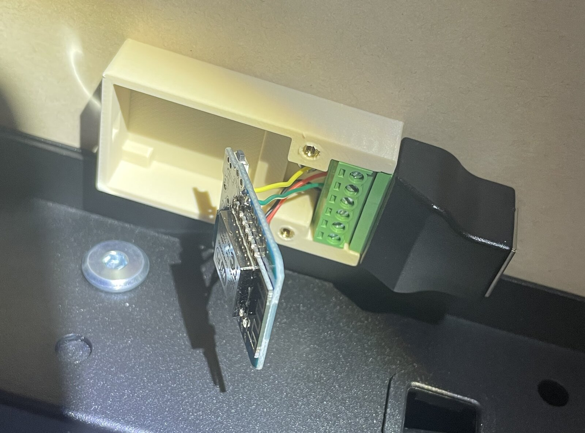
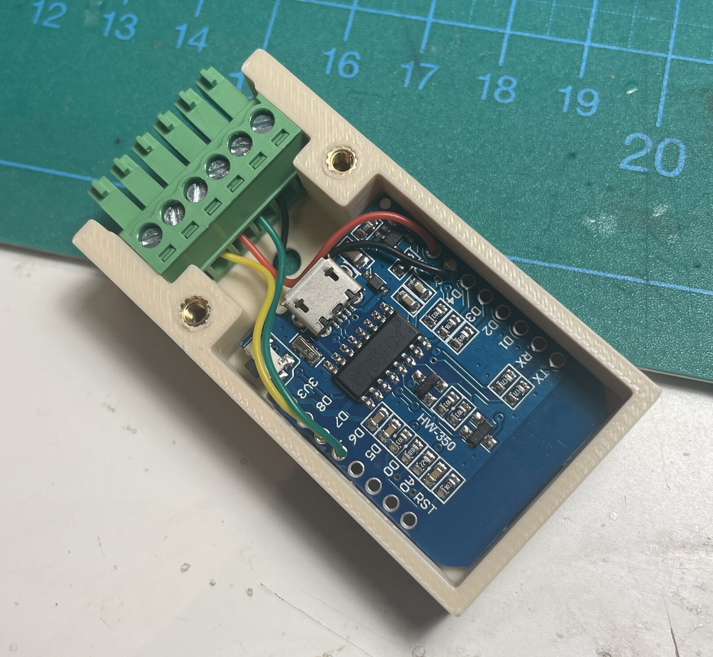
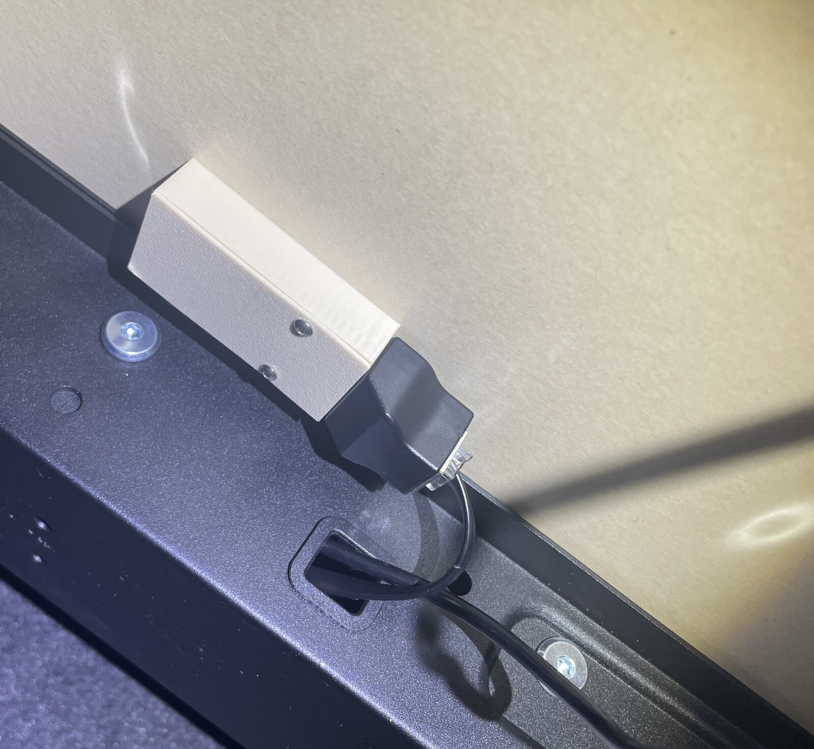

# Mittzon ESPHome

A tiny ESPHome controller to connect your IKEA Mittzon standing desk with Home Assistant. I'm using a Wemos D1 Mini in a cool 3D printed box under the desktop, plugging into the spare RJ12 port on the desk's control box. That port is meant for a Bluetooth remote (not one IKEA sells), and it carries 5V and UART, so it can power the D1 and take commands without any extra parts. You get five buttons in Home Assistant: **Preset 1 (Sitting)**, **Preset 2 (Standing)**, **Up**, **Down** and **Stop**. The original IKEA hand switch stays connected and keeps working like before.

<p align="center">
  
  
</p>

Right now I just have it in Home Assistant, but the plan for later is to hook it up to a seat sensor or a camera with image recognition, so the desk moves up on its own when I've been sitting for too long (because I forget I can do that and sit like Gollum all day).

### Four things you should know before you build this

**You're plugging into your desk's electronics, do this at your own risk.** It works fine on mine, but I'm not responsible for any damage to your desk, control box or anything else. Measure before you connect anything (see [Wiring](#wiring)).

**The protocol and ESPHome config are AI-written.** I came up with the idea and designed the enclosure, and worked out the protocol and the YAML together with Claude. It's working fine for me, but maybe your Mittzon controller is different. If you encounter any problems or weirdness, open an issue, PR or ask for help on my [Discord](https://glnnk.art/discord).

**I've only tested this on my own Mittzon.** I can't say anything about other desks or other versions/sizes of the Mittzon.

**It only talks, it doesn't listen.** The controller sends commands to the desk but doesn't read anything back, so Home Assistant doesn't know the current height. It may be possible, but I couldn't get any signal back from the controller at all.

> [!TIP]
> Join my [Discord Server](https://glnnk.art/discord) for build support and discussion.

---

## Contents

- [Bill of Materials](#bill-of-materials)
- [3D print files](#3d-print-files)
- [Wiring](#wiring)
- [Assembly](#assembly)
- [Flashing ESPHome](#flashing-esphome)
- [Using it](#using-it)
- [The protocol](#the-protocol)
- [License](#license)

---

## Bill of Materials

<p align="center"></p>

| Part | Qty | Notes |
|---|---|---|
| Wemos D1 Mini | 1 | I use the ESP8266 / micro USB one. **Without headers!** The case has no room for them. The more recent USB-C ones might not fit. Please test it and let me know, it should be a simple adjustment of the lid |
| [RJ12 screw terminal, solderless](https://www.amazon.de/-/en/dp/B0FX8R5L5W) | 1 | The green bit slots perfectly into the printed box. Also see the [pigtail version](#pigtail-version) below |
| [RJ12 cable, male-male](https://www.amazon.de/-/en/dp/B005I1UE3E) | 1 | From the desk's control box to the controller. Not needed with the pigtail version |
| Short lengths of wire | 4 | Between the terminal and the D1 |
| M2.5 heat-set insert | 2 | |
| M2.5 screw, 5–8mm | 2 | Hold the lid on |
| Small wood screw, M3 screw or double-sided tape | 1 | Optional, to mount the box under the desk |

### Pigtail version

There's also an [RJ12 terminal with a short pigtail cable](https://www.amazon.de/PENGLIN-RJ12-Stecker-Schraubklemmenblock-Adapter/dp/B0DNVH6ZXB) between the plug and the screw block. **I haven't tested this one**, but the green screw blocks look pretty standardized, so it will probably fit. If it does, it's the cleaner option: you don't need the RJ12 cable at all. Plug it straight into the control box and put the closed box in the frame tray next to it. Easiest to do before you assemble the desk.

## 3D print files

Everything's in [`hardware/`](hardware):

- **`hardware/box.stl`** — the base. Print it with the floor on the buildplate. The big hole in the middle of the floor is for mounting it to the desk.
- **`hardware/lid.stl`** — the STL is exported in its assembled position, so flip it over and print it with the flat top on the buildplate (the little pin on one end pointing up).

These are designed to print without supports. The tolerances are tight on purpose: the D1 isn't screwed down, it's held in place by the clamping force between the base and the lid. If your printer runs a bit over- or undersized, check the fit before you mount anything.

If you wanna make changes to the model, here is the [Onshape project](https://cad.onshape.com/documents/be0ed813f29f32c99d83cd0a/w/2493a9bd2c40317c02d69d8a/e/a6bc11c658a43d4e14ed064d?renderMode=0&uiState=6acf975f4afd81f4f5f56728).

> [!IMPORTANT]
> If you want to build and sell this project commercially, you'll need a paid Onshape license.

## Wiring

The desk's control box uses a 6-pin RJ12 connection. Only four of those pins are needed:

| RJ12 pin | Desk side | Wemos D1 Mini pin | Notes |
|---|---|---|---|
| 1 | NC / Wake | — | Leave disconnected |
| 2 | GND | `G` | Logic ground |
| 3 | Desk TX | `D6` (GPIO12) | Microcontroller RX |
| 4 | +5V | `5V` | Powers the D1 |
| 5 | Desk RX | `D7` (GPIO13) | Microcontroller TX, this is where the commands go out |
| 6 | NC | — | Leave disconnected |

There's no level shifter between the desk and the D1. I didn't think about it when I built it, and it's been working fine without one so far. If the control box were sending out 5V data signals on its TX pin, that might cause problems for 3.3V MCUs. As far as I can tell it only reads from the D1, but never responds (or I instantly fried my D1's RX pin, we'll never know).

**Finding pin 1:** looking into the RJ12 socket with the notch facing down, pin 1 is on the left. Looking at the screw terminal from the back (into the holes where the wires go), pin 1 is on the right.

> [!WARNING]
> Before you connect the D1, measure between pin 2 (GND) and pin 4 (+5V) on the RJ12 terminal with a multimeter. It should read ~5V DC. If it doesn't, your controller is different or you're measuring the wrong pins. Also: **disconnect pin 4 (+5V) before plugging the D1 into a computer via USB**. This should only be necessary for the initial flash, afterwards just keep it connected to the desk and use the OTA-update / serial over WiFi.

## Assembly

### 1. Heat-set inserts

<p align="center"></p>

Press the two M2.5 inserts into the two posts next to the terminal opening.

### 2. Wires

<p align="center"></p>

Strip and tin both ends of the four wires. Solder one end of each to the D1 following the [pinout](#wiring), then screw the other end into the RJ12 terminal. Keep them short, there's not a lot of room in there.

If you haven't flashed the D1 yet, do it now, before closing the box. See [Flashing ESPHome](#flashing-esphome), and remember to keep it disconnected from the desk while it's powered via USB.

### 3. Mount the box

<p align="center">
  
  
</p>

Screw the box to the underside of the desk through the big center hole (or use double-sided tape). Then slot in the RJ12 terminal — it's tight enough to hold on its own.

### 4. D1 and lid

<p align="center">
  
  
</p>

Slot the D1 into the box. **Make sure the wires run to the left and right of the USB port**, not over it, or the lid won't close properly. Since the box is mounted upside down by now, this is a bit fiddly. A thin bit of double-sided tape might help keep the D1 in place while you do it.

Put on the lid: it goes on in a little angled/sliding move, to align the little pin on the lid with the hole on the D1 end. Then use the two M2.5 screws on the other end to hold everything closed.

Plug the RJ12 cable into the spare port on the desk's control box (ideally, you've done this while assembling the desk because unscrewing and re-screwing the desktop is a massive pain in the rear) and into the terminal. With the [pigtail version](#pigtail-version), plug it straight into the control box instead.

## Flashing ESPHome

The config is in [`esphome/mittzon-desk.yaml`](esphome/mittzon-desk.yaml). You need [ESPHome](https://esphome.io/guides/installing_esphome/) installed.

Put your WiFi credentials in the `wifi:` section first:

```yaml
wifi:
  ssid: "YOUR_SSID"
  password: "YOUR_PASSWORD"
```

Then execute this in a terminal pointed to the folder your YAML sits in:

```
esphome run mittzon-desk.yaml
```

The first flash goes over USB. After that, OTA is enabled, so later updates go over WiFi and you don't have to take the box off the desk again.

**Other boards:** any ESPHome-compatible board with a free UART should work. Change `board:` and the `tx_pin` / `rx_pin` in the `uart:` section to match. I haven't tested any, and the case only fits a D1 Mini.

## Using it

Once it's on your network, Home Assistant should discover it through the ESPHome integration. Add it, name it, assign a room and you get five buttons:

| Button | What it does |
|---|---|
| Desk Preset 1 (Sitting) | Moves to memory position 1 |
| Desk Preset 2 (Standing) | Moves to memory position 2 |
| Desk Up | Moves up one step |
| Desk Down | Moves down one step |
| Desk Stop | Stops the desk |

Put them on a dashboard, use them in automations. The Desk Up / Down steps are kinda rough, so the two Presets are probably the most useful. But you could use Up / Down as a little wake up / reminder.

**The presets are stored in the desk's control box, not in ESPHome.** Set them with the hand controller, see the [IKEA manual, page 5](https://www.ikea.com.tw/dairyfarm/tw/pdfs/advice/en/003/AA-2415003-4_pub.pdf).

## The protocol

In case you want to experiment with getting more info in / out of the desk: It runs at 9600 baud UART, 8N1. Every frame is 6 bytes:

```
[0xF1, 0xF1, CMD, 0x00, CHECKSUM, 0x7E]
```

The checksum is just the command byte again.

| Command | Frame |
|---|---|
| Wake | `F1 F1 00 00 00 7E` |
| Preset 1 (Sitting) | `F1 F1 05 00 05 7E` |
| Preset 2 (Standing) | `F1 F1 06 00 06 7E` |
| Up | `F1 F1 01 00 01 7E` |
| Down | `F1 F1 02 00 02 7E` |
| Stop | `F1 F1 2B 00 2B 7E` |

The YAML script sends a wake frame first, waits 80ms, then sends the actual command. Without this, the first button press always does nothing.

## License

MIT — see [`LICENSE`](LICENSE). Covers everything in this repo: ESPHome config, 3D files and docs.

> [!IMPORTANT]
> If you want to build and sell this project commercially, you'll need a paid Onshape license.

# The End
I hope this was a fun project and you got through with ease. If you're having difficulties at any point, please reach out. You can join my [Discord Server](https://glnnk.art/discord) for support.
I'd also love to see your creations! Tag me on Instagram or send me a photo to add here.
Check out my other stuff on [YouTube](https://glnnk.art/youtube) or [Instagram](https://instagram.com/glnnk.art).
You can [Buy me a coffee](https://www.paypal.com/paypalme/finnglink) if you've found my work helpful :)
